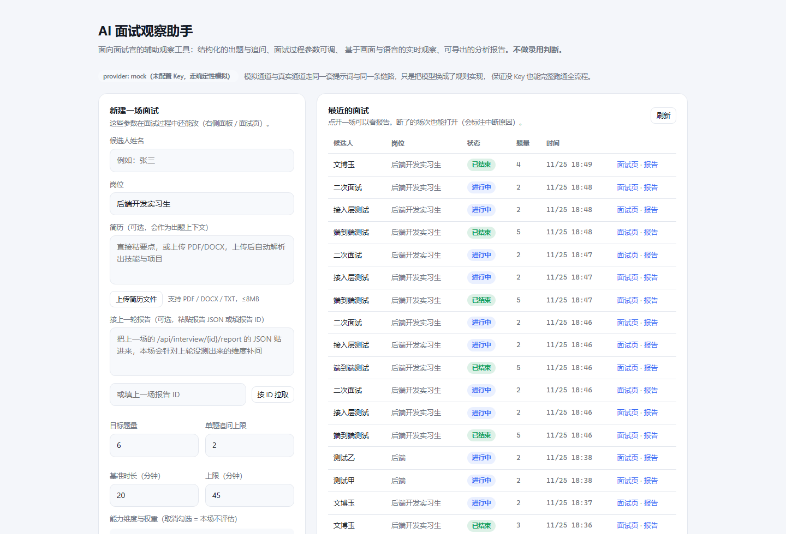
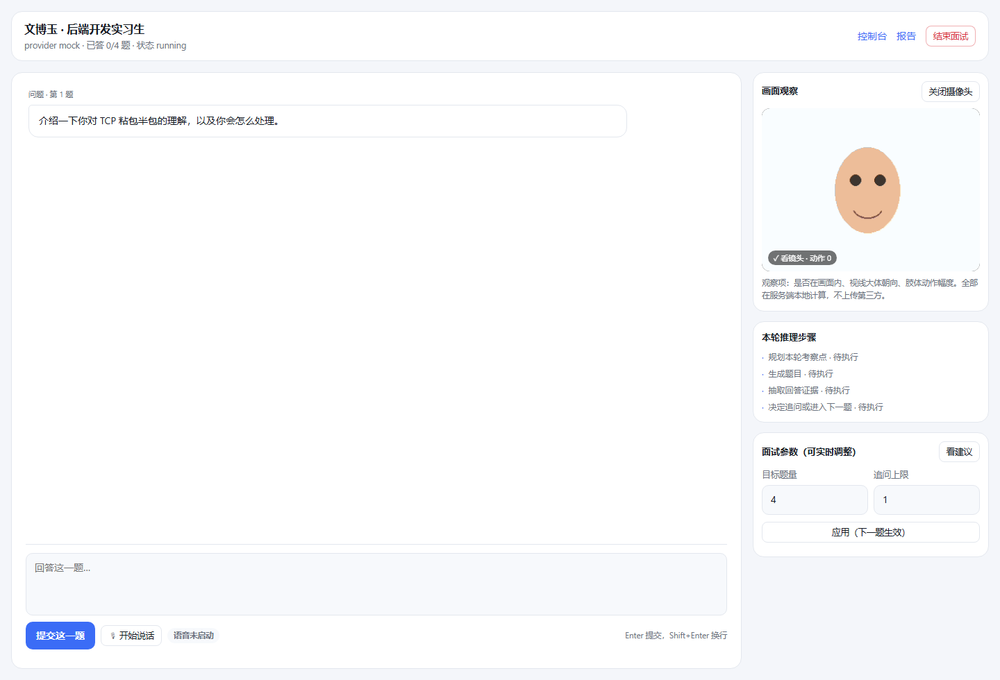
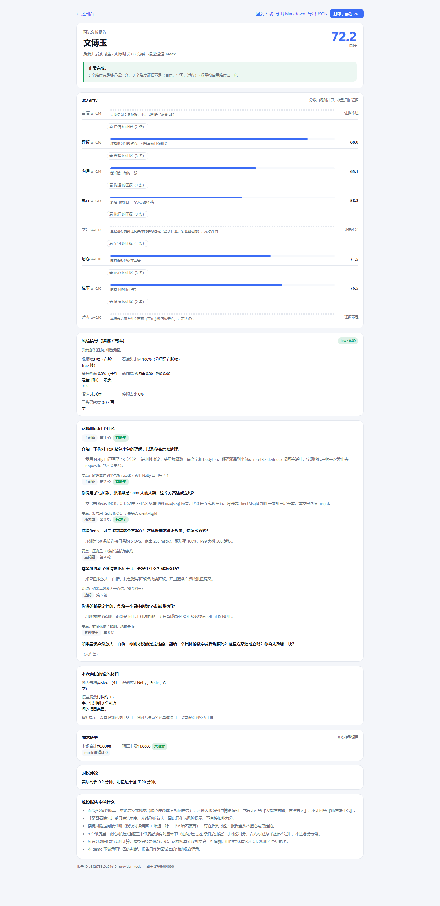

# 智能面试观察助手（smart-interviewer）

面向面试官的**辅助观察工具**：AI 出题、按缺口追问、在指定环节施加压力与条件变更，
同时用摄像头与语音做过程观察，最后导出一份**带分数与证据**的分析报告。

一句话说清边界：**它不做录用判断**。报告是给面试官的观察记录，不是决策结论。

> 演示通道默认 `mock`（不需要任何 API Key 就能完整跑通全流程）；
> 填入 `DASHSCOPE_API_KEY` 后自动切到通义千问真实模型通道。



<table>
<tr>
<td width="50%"><br><sub>面试页：右侧观察区实时出画面与推理步骤</sub></td>
<td width="50%"><br><sub>报告页：8 维度打分 + 证据 + 风险信号 + 成本</sub></td>
</tr>
</table>

> 图里的「脸」是合成测试视频（见 `_shots/README.md`），证明的是抽帧→启发式→落库→报告
> 这条链路通了，不是人脸识别准确率。

---

## 一分钟看懂

| 招聘要求里的那条 | 这个 demo 怎么落 |
| --- | --- |
| 面部/肢体/语言识别，输出观察记录与建议 | 浏览器每 3 秒抓帧 → 服务端 Pillow+numpy 算「在不在画面、视线偏没偏、动作幅度」；语音走转写与语速/停顿统计 |
| 过程参数可人工调整（看镜头、读稿风险、耐心/自信/理解/学习/适应/抗压/沟通/执行） | 8 个维度带权重，可勾选、可改权重；`POST /adjust` 面试进行中即时生效；`GET /pacing` 按当前证据给出「延长/缩短」建议 |
| 云服务器部署 | 单进程 Starlette + SQLite，一条 uvicorn 命令起来，无外部依赖 |
| 流程自洽、多端适配 | 桌面与手机浏览器同一套响应式布局（640px 以下单列），Web 优先 |
| 实时提问和分析，固定环节 + agent 负责追问 | LangGraph 五个节点：规划 → 出题 → 分析 → 决策 → 收尾；决策节点决定追问/压力/变更/下一题/结束 |
| 调通用模型、结构化提示词、不做微调与知识库 | 6 个结构化提示词（角色/任务/约束/输出 schema 四段式），零微调、零向量库 |
| 导出含分数的报告 + 异常兜底 + 成本核算 | 报告三个出口：JSON（可再喂回下一轮）、Markdown、可打印 HTML；四类异常各自有判定与话术；每次模型调用都记 token 与耗时，按价目表算钱 |
| 从简历、报告等接入，AI 辅助分析，形成新报告与建议 | 简历支持 PDF/DOCX/TXT 上传解析（技能词典 + 项目抽取 + 年限），上一轮报告 JSON 直接导入，本轮针对上轮没测出来的维度补问 |
| 较成熟的商业化方案 | 按场次配额（超限 402）、单场预算熔断（超预算降级但不中断面试）、审计日志；成本账本按用途/模型汇总 |
| 其他技术补充 | 见下方「设计取舍」与 `docs/ARCHITECTURE.md` |

---

## 快速开始

```bash
cd smart-interviewer

# 0) 装依赖（版本是本机实测跑通的，见 requirements.txt）
pip install -r requirements.txt

# 1) 起服务（不需要任何 Key，走 mock 通道）
python -m uvicorn app.main:app --host 127.0.0.1 --port 8090

# 2) 打开控制台
#    http://127.0.0.1:8090/
```

**走一遍完整流程**：

1. 控制台填候选人姓名、岗位、简历要点 → 「开始面试」
2. 面试页右侧点「开启摄像头」（浏览器会要权限）→ 允许
3. 把 AI 的问题读一遍，用语音或键盘回答 → 提交
4. 观察右侧「本轮推理步骤」：规划 → 出题 → 抽证据 → 决策，每一步都在
5. 觉得够了就点「结束面试」，或让它自己答满目标题量
6. 自动跳到报告页 → 「打印 / 存为 PDF」导出一份

**要用真实模型**：

```powershell
$env:DASHSCOPE_API_KEY = "sk-xxxx"
python -m uvicorn app.main:app --port 8090
```

控制台顶部会从 `provider: mock` 变成 `provider: dashscope`。

模型：文本 `qwen-plus`、视觉 `qwen3-vl-plus`、实时语音 `qwen3.5-omni-flash-realtime`（voice=`Tina`）。

> 这三个名字不是抄文档抄来的，是拿真实 Key 调 `GET /compatible-mode/v1/models`
> 逐个试出来的：`qwen-vl-max` 在当前账号返回 **404 Model not exist**，
> `qwen-vl-plus`/`qwen-vl-max-latest` 返回 **403 Access denied**，
> 只有 `qwen3-vl-plus` 是 200；`qwen-omni-turbo-realtime` 能建连但立刻回
> `InvalidParameter: Model not exist`（看着像连上了，其实一句都收不到），
> 换 `qwen3.5-omni-flash-realtime` 才跑通。另外 `update_session` 不传 `voice`
> 时 SDK 会发 `voice="null"`，服务端报 `Voice 'null' is not supported`。
> 这几条坑都写在 `app/config.py` 的注释里，改模型名时先看那里。

---

## 项目结构

```
smart-interviewer/
├── app/
│   ├── config.py              8 个维度定义 / 权重 / 价目表 / Settings
│   ├── db.py                  SQLite：6 张表（append-only 事件表为主）
│   ├── main.py                Starlette 路由（页面 + API + WebSocket）
│   ├── agent/
│   │   ├── state.py           TurnState（一轮状态）/ InterviewRuntime（外部依赖）
│   │   ├── nodes.py           5 个节点：prepare/generate/analyze/decide/closing
│   │   └── graph.py           StateGraph 组装与 run_turn
│   ├── api/
│   │   └── session.py         会话层：状态重建、出题、提交、兜底判定、参数调整
│   ├── providers/
│   │   └── llm.py             MockProvider（规则）/ DashScopeProvider（真实）+ 成本核算
│   ├── vision/
│   │   └── analyzer.py        纯本地启发式视觉：肤色连通域 + 帧间差异
│   ├── audio/
│   │   └── analyzer.py        语速/停顿/口头语/书面语密度 + Qwen-Omni 实时会话
│   ├── intake/                接入层：简历与上一轮报告的解析（不调模型也能跑）
│   │   ├── resume.py           PDF/DOCX/TXT → 技能/项目/年限；解析失败降级不阻断
│   │   └── report.py           上一轮报告 → 本轮追问点（纯结构化集合运算）
│   ├── scoring/
│   │   └── engine.py          8 个维度的评分规则（证据不足就不出分）
│   ├── report/
│   │   ├── builder.py         报告组装
│   │   └── export.py          三出口：json / markdown / 可打印 html
│   ├── billing/               商业化：配额、预算熔断、审计
│   │   ├── quota.py           tenant / tenant_usage / audit_log + 原子累加
│   │   └── guard.py           GuardedProvider：超预算降级，但不中断面试
│   ├── templates/             console.html / interview.html / report.html
│   └── static/                style.css / console.js / interview.js + PWA manifest
├── tests/
│   ├── test_fallbacks.py      19 个用例（异常兜底 + 评分 + 视觉 + 音频规则）
│   └── test_intake.py         27 个用例（解析/降级/报告吸收/导出/加列迁移）
├── tools/
│   ├── e2e_api.py             端到端 API 断言（82 项）
│   ├── shot.py                headless Edge + CDP 截图（7 张，含深色模式）
│   ├── make_fake_y4m.py       生成"人脸"假视频，给 headless 假摄像头用
│   └── seed_demo.py           播两场体面样例（把时间轴铺开成真实时长）
├── docs/
│   ├── DESIGN.md              技术判断与取舍
│   └── ARCHITECTURE.md        分层、AI 边界、扩展点、商业化、多端现状
├── requirements.txt           本机实测可用的依赖版本（不用 FastAPI/SQLAlchemy/pytest）
└── data/interview.db          SQLite（首次启动自动建）
```

---

## 架构

```
                    ┌──────────────────────────────────────┐
   浏览器            │  Starlette 单进程                     │
 ┌──────────┐       │                                      │
 │ 控制台   │──POST─▶ /api/interview       建场次           │
 │ 面试页   │──POST─▶ /{iid}/answer ──┐                     │
 │ 报告页   │──POST─▶ /{iid}/frame     │                    │
 └──────────┘──POST─▶ /{iid}/audio     │                    │
      ▲               └─────┬───────────┘                    │
      │                     ▼                                │
      │            ┌────────────────┐   每提交一次回答跑一次图 │
      │            │ Session 会话层  │──────────────────────┐ │
      │            │ 状态从 DB 重建  │                      │ │
      │            └────────────────┘                      ▼ │
      │                                       ┌──────────────────────┐
      │                                       │ LangGraph            │
      │                                       │ prepare → generate   │
      │                                       │   ↓                  │
      │                                       │ analyze → decide     │
      │                                       │   ↓  条件边           │
      │                                       │ closing / END        │
      │                                       └──────────────────────┘
      │                                                   │
      └────────────── HTML / JSON ◀── 评分规则 ◀── SQLite ◀┘
```

**为什么「每提交一次回答跑一次图」**：把整场面试做成一张长图 + `interrupt` 等用户输入，
进程重启、网络抖动都会让图挂住，还得引入 checkpointer。本项目让图保持纯函数
（进一次、出一次），状态由会话层从 DB 重建。代价是「跨轮规划」要在 state 里显式维护——
但这本来也应该显式。

---

## 8 个能力维度的评分口径

| 维度 | 权重 | 主要证据 | 什么时候不出分 |
| --- | --- | --- | --- |
| 自信 confidence | 0.14 | 回避词密度、语速稳定性、视线稳定度 | 证据 < 3 条 |
| 理解 comprehension | 0.16 | 是否答到点、是否跑题、关键论点数量 | 证据 < 3 条 |
| 沟通 communication | 0.14 | 结构词、句长分布、填充词密度 | 证据 < 3 条 |
| 执行 execution | 0.14 | 具体数字、举例、动作动词 | 证据 < 3 条 |
| 学习 learning | 0.12 | 学习动作词（学了什么、怎么验证） | 没有学习动作词 |
| 耐心 patience | 0.10 | 追问后回答长度的保持率 | **必须出现过追问轮** |
| 抗压 stress | 0.10 | 压力题前后回答质量差 | **必须出现过压力题** |
| 适应 adaptability | 0.10 | 条件变更后的调整词命中、与旧答案的重合度 | **必须出现过变更题** |

**两条硬规则**：

1. **证据不足的维度不进总分分母**。宁可标「证据不足」也不给一个 0 分。
2. **分数由代码规则算，模型只抽取证据**。同一份回答重算必须得到同一个分数，可追溯、可复盘。

后三个维度「必须出现过对应环节」是有意的：一场没追问的面试，本来就无法观察耐心。

---

## 过程观察（视觉与语音）

**视觉**（`app/vision/analyzer.py`，纯本地，不调模型）：

- YCbCr 肤色阈值 → 64×48 上找最大连通域 → 面积过滤（<0.6% 判噪声、>60% 判误检）
- 帧间差算动作幅度；中心偏移算「大概在看哪」
- **看镜头比例的分母是「有脸的帧」**，离开画面比例的分母是「全部帧」——
  否则偏头看稿会被算成「没看镜头」，双重惩罚
- 结果只作风险提示，**不直接扣能力分**

**语音**：浏览器 Web Speech API 做转写，前端上报 `transcript / pause / speed` 三类事件。
服务端算语速变异系数（`cv`）判断稳定性、停顿占比、口头语密度、书面语密度。

**读稿风险**是间接推断（视线持续偏离 + 语速过于平稳 + 书面语密度高），
报告里写成风险信号，从不写成定论。

---

## 接入层：简历与上一轮报告

这是需求原文「能从提供的简历、报告等接入 demo」对应的部分，也是这个项目里
**唯一一块完全不用模型的模块**——它全部是确定性的解析与集合运算。

### 简历

`app/intake/resume.py`：

| 能力 | 怎么做 | 掉了什么坑 |
| --- | --- | --- |
| PDF / DOCX / TXT | pypdf 抽页、python-docx 读段落**加表格单元格**（很多人把技能塞进表格）、纯文本按 UTF-8 → GBK 依次尝试 | 老式 `.doc` 是二进制格式，明确报错让用户另存，不猜 |
| 技能识别 | 45 项技能词典做小写包含匹配，按长度倒序 | 不倒序的话 `Spring` 会把 `Spring Boot` 吃掉，只剩半截 |
| 项目抽取 | 有「项目经历」块就按要点符号分条；没有就用正则找「…系统/平台/服务/引擎」兜底 | 兜底最多取 3 条，宁可少不能乱 |
| 工作年限 | **只在「工作经历」块里**找 `2024.09-2025.11` 这样的区间 | 全文找会把教育经历 `2024.09-2028.06` 算成"3.8 年经验"，比不写更糟 |
| 解析失败 | PDF 是扫描件、文件损坏、超过 8MB → 抛 `ValueError`，接口转成 `warnings` 继续建场次 | pypdf/python-docx 抛的异常类型很杂（不止 `ValueError`），不统一会让接口 500 |

解析结果不是拼一段散文塞给模型，而是结构化的 `ResumeProfile`（技能列表、项目标题+要点+技术栈、年限），
`prompt_text()` 只输出这几项，不把简历原文整段塞进上下文——原文里有大量与提问无关的排版噪音。

### 上一轮报告

`app/intake/report.py` 把上一场的报告 JSON 读回来，算出这一轮要补什么：

- `scored_dims`：上轮已出分的维度（字典，维度名 → 分数）
- `insufficient_dims`：上轮证据不足、没给分的维度 —— **这是二次面试的全部意义**
- `probe_points`：上轮答了但没形成要点的题、追问了但没答的题

**为什么不调模型**：「哪些维度没测出来」是确定的集合运算，让模型转述一遍只会引入失真。
模型的机会在出题阶段——`Providers` 会把 `probe_points` 写进提示词。

接上一轮的效果在 mock 通道下也看得到：`MockProvider.question` 会优先从
`prior_report.probe_points` 里取题，没有才用简历里的项目名，再没有才退回题库。
（这一条是后来补的：一开始只有真实模型通道吃简历和上轮报告，
演示时用 mock 完全看不出"接入层生效了"，等于白做。）

---

## 商业化：三件事做实，三件事不做

| 做实 | 为什么 |
| --- | --- |
| 按场次配额（`tenant_usage` + `monthly_quota`） | 这是最容易卖的单位。超限返回 **402** 并带 `used/limit/period/plan`，前端能直接引导升级 |
| 单场预算熔断（`BudgetGuard`） | 防止一次异常重试把账单打爆。**刻意不中断面试**——候选人答到一半被踢出去，比多花两毛钱严重得多 |
| 审计日志（`audit_log`） | 建场次/结束/熔断都留痕。To B 客户第一个问的就是"能不能查谁用了" |

| 不做 | 为什么 |
| --- | --- |
| 支付、发票 | 接第三方，不是这个阶段该做的事 |
| 强多租户隔离 | 现在共用一个 SQLite；上生产要拆库或换 Postgres |
| SSO | 企业客户会要求，但 demo 阶段没有真实客户提 |

降级不静默：每次熔断都落一条 `audit(outcome="denied")`，报告页会写
「本场有 N 次调用因超出预算降级为规则化实现」——客户能自己判断这份数据有多少来自模型。

---

## 四类异常兜底

| 异常 | 判定 | 报告怎么写 | 怎么不卡死 |
| --- | --- | --- | --- |
| 面试时长 0 | 已结束且时长 < 1 秒，或压根没答过题 | 明确写「没有产生有效问答，不生成评分」，总分留空 | 报告照样能打开，不 500 |
| 中途离开 | 连续无人脸 ≥ 20 秒 | 写「检测到最长 N 秒画面中没有人脸」 | 只告警，不中断面试 |
| 录音为空 | 所有回答都是空文本 | 写「可能是麦克风未授权或未开录音」 | 键盘输入照样能完成面试 |
| 网络中断 | 候选人侧超过 3 分钟无新事件 | 写「会话中断，可从断点继续」 | 重开后从 DB 恢复，题不丢 |

> 判定「停滞」只看**候选人侧**信号（提交、帧、音频），不看「服务端什么时候出过题」——
> 服务器问完题在等人答，这段等待本来就是它该有的样子。第一版把出题时间算进去，
> 结果永远判不出停滞。

---

## 没有服务器怎么演示

这个 demo 不需要云服务器也能完整跑：**单进程 + SQLite，一条 uvicorn 命令**。
只有 Key 没有服务器时，按这几种方式给对方看：

| 场景 | 做法 | 对方能看到什么 |
| --- | --- | --- |
| 发代码 | GitHub 仓库 + 本文件 + `_shots/` 截图 | 完整源码、架构、7 张实跑截图 |
| 让人自己跑 | 对方 `git clone` → 一条命令 → 打开 `127.0.0.1:8090` | 不填 Key 走 mock 通道能跑完全流程；填 Key 走真模型 |
| 当面演示 | 本机起服务 + 屏幕共享 | 摄像头抽帧、追问、报告导出全都能看 |
| 录屏 | 起服务后录一遍完整面试 | 适合对方没时间装环境 |
| 真要公网 | 任意 1C2G 云主机，`--host 0.0.0.0`，开 8090 端口 | 需要自己买机器，代码不用改 |

用环境变量切换，不改代码：

```bash
# 只用 mock（默认，无 Key 也能跑）
python -m uvicorn app.main:app --host 0.0.0.0 --port 8090

# 接真实模型
export DASHSCOPE_API_KEY=sk-xxx          # Windows: $env:DASHSCOPE_API_KEY="sk-xxx"
export SI_PROVIDER=dashscope             # 可选，auto 时检测到 Key 自动切
export SI_VISION_USE_MODEL=1             # 可选，开云端视觉（每场多约 ¥0.5）
python -m uvicorn app.main:app --host 0.0.0.0 --port 8090
```

---

## 成本核算

价目表在 `app/config.py:PRICING`，每次调用都记 `input_tokens / output_tokens / audio_ms`。

**一场 20 分钟标准面试（11 轮问答 + 400 帧视觉 + 15 分钟实时音频）的估算**：

| 用途 | 调用次数 | 估算成本 |
| --- | --- | --- |
| 出题/分析/决策（qwen-plus，均值 900 in / 220 out） | 33 | ¥0.04 |
| 视觉（qwen3-vl-plus，实测 252 in / 55 out 每张） | 400 | ¥0.50 |
| 实时语音（qwen3.5-omni-flash-realtime，¥0.05/分钟） | 20 分钟音频 | ¥1.00 |
| **合计** | 434 | **≈ ¥1.54** |

关键结论：**钱几乎全花在视觉和语音上，文本推理可以忽略**。
所以降本要降采样率，不是换更便宜的文本模型：

- 视觉 3 秒一帧 → 8 秒一帧，成本直接降到约 1/3
- 语音只在候选人说话时开流（VAD 门控），静默不计费
- 只有命中「可疑帧」才送视觉模型（先用本地启发式筛，本地判不了才上云）
  —— 这就是默认 `SI_VISION_USE_MODEL=0` 的原因：本地那条通道免费，
  云端那条按张算钱；开着它一场多花约 ¥0.5，换一个本地算不出来的「头部朝向」。

价目表里查不到的模型不会算成 0 元，而是进 `unpriced_models` 列表在报告里标出来
——「成本 0」和「我不知道多少钱」必须能分开。

---

## 验证

```bash
# 单元测试（46 个用例：四类兜底 + 评分 + 视觉 + 音频 + 接入层/导出/迁移）
python -m unittest discover -s tests -v

# 端到端 API 断言（82 项：主链路 + 接入层 + 导出 + 配额审计）
python tools/e2e_api.py

# 截图回归（7 张，含深色模式）
python tools/shot.py
```

实测输出：单元测试 `Ran 46 tests ... OK`；端到端 `PASS=82 FAIL=0`；
截图脚本 7 步全过（含导出三出口的字节数断言）、`window.__errs = []`。

端到端脚本第 10–14 段专门覆盖这次新增的部分：DOCX 上传后解析出技能与项目、
上一轮报告导入后首题确实换了方向、三出口导出、额度为 0 的租户拿到 402、
审计日志里有建场次与结束两条。

**真实模型通道也跑过**（不是只跑 mock）：填了真实 Key 后从建场次到出报告走完整一场，
9 次 `qwen-plus` 调用全部成功，报告正常出分（77.4 / 良好），成本记账
`¥0.0038`、`unpriced_models: []`。三个模型的可用性是对着真实 Key 逐个试出来的，
不是抄文档——踩坑记录见 `app/config.py` 的注释。

**样例数据**：`tools/seed_demo.py` 会播两场体面样例（一场完整、一场很短），
用于看控制台和报告长什么样。它会调 `_backdate()` 把时间轴铺开成真实时长，
否则脚本跑出来的场次 `started_at` 与 `ended_at` 差几百毫秒，会被
「时长 0」兜底正确判成 `no_progress`——那是对的逻辑，只是样例看起来像坏数据。

> 假摄像头说明：headless Edge 默认给的是绿色测试图案，里面没有肤色区域，
> 视觉启发式会正确地判「未检测到人脸」。`tools/make_fake_y4m.py` 生成一段
> 合成的"人脸"视频当输入，这样截图里能看出「在画面内」的完整链路。
> 它证明链路通，**不证明真人识别准确率**。

---

## 已知局限

1. **视觉是启发式，不是人脸识别**。它能回答「大概在看哪、有没有人」，不能回答「他在想什么」。
2. **看镜头受角度光线影响大**，只作风险提示，不扣分。
3. **前端语音用 Web Speech API**，Chrome/Edge 可用，Firefox 需要开关。真实生产建议直接接 Qwen-Omni 双向流。
4. **mock 通道是规则化的**，它的追问逻辑可复现但不聪明；填 Key 后才是真模型。
5. **单机 SQLite**，并发面试超过几十场要换 Postgres。
6. **不做录用判断**，也不做 ATS 后续流程——这是产品定位，不是没做完。
7. **小程序/原生 App 没做**：小程序不能直接用 `getUserMedia` 和 Web Speech API，
   要重写整个采集层；当前用 PWA（可加到主屏）+ 响应式布局覆盖手机场景。
8. **简历解析是规则化的**：技能靠 45 项词典、项目靠标题模式与正则。
   换一份排版很特殊的简历会漏识别（会落进 `warnings` 而不是报错）。

---

## 设计取舍（展开在 `docs/DESIGN.md` 与 `docs/ARCHITECTURE.md`）

- 用 Starlette 不用 FastAPI：沙箱装不上 fastapi，而 Starlette 该有的都有
- 每轮跑一次图，不做长图 + interrupt：图是纯函数才能单测、才能重放
- 分数用代码规则算：模型抽取证据会漂，规则不会
- 证据不足不出分：比给个 0 分诚实
- 报告用 HTML 可打印：不引 PDF 库，浏览器自带的打印引擎质量更好
- 兜底写进报告而不是弹窗：面试官事后复盘时，最需要知道的是「这份报告哪里不可信」
- 简历/报告接入全用规则，不调模型：集合运算要的是确定，不是智能
- 超预算降级但不中断面试：候选人答到一半被踢出去，比多花两毛钱严重得多
- 材料存 JSON 列不拆表：只在建场次时写一次、每轮读一次，拆表要 3 表 6 JOIN
